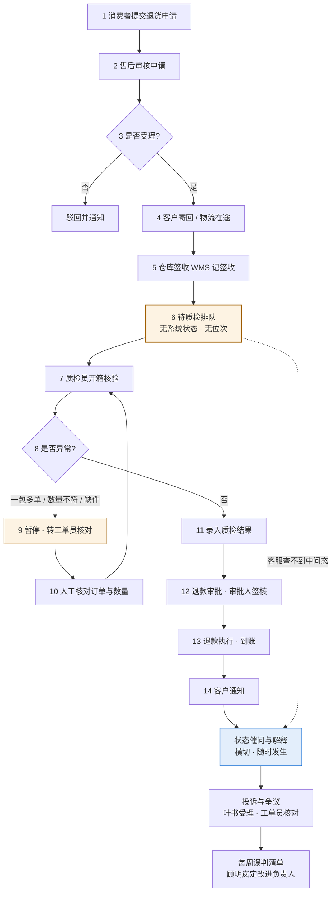

# 阶段 02 · 现场调研分析

**项目：万象优选 · 退货验收与售后协同**  
**分析对象：签收后等待不可见 · 异常件分派 · 完成口径冲突**  
**依据：6 位角色、33 轮访谈、35 条事实（`02_调研记录.*`）**  

| 项目 | 内容 |
| --- | --- |
| 阶段 | 02 现场调研（阶段工作台：业务挖掘实验室） |
| 核心任务 | 02-1 角色访谈 / 02-2 还原现状流程 / 02-3 四来源收敛与材料核对 |
| 阶段关卡 | 关键流程、异常、证据矛盾和待核实项均已形成记录 |
| 分析日期 | 2026-11-05 |
| 核对资料 | `项目原有资料/` 四份：项目简报 v1.0、退货验收 SOP v3.2、数据说明 v1.4、周报 2026-W44 |

---

## 0. 分析结论

1. **瓶颈定位：不在"质检慢"，在"签收之后没有任何系统状态"。** 签收由 WMS 记录，质检排队不在任何系统里，客服台又拿不到 WMS 的中间态。三个系统各说各话，消费者得到的是"已签收"和"还没轮到"之间的真空。
2. **6 天不可归因。** 各节点等待/处理时间从未分别计量（f01），现有数据里"签收"与"验收"还被混用（f31）。因此"6 天 → 3 天"目前只能作为目标，不能作为验收口径。
3. **42% 是一个没有分母的百分比。** 顾明岚给出占比，叶书提出"按包裹还是按查询"（f51）。分母不定，价值测算会差一倍以上。
4. **真正的异常成本在"停线核对 + 口头转交"。** 一包多单、数量不符的件必须停下核对（f11），而转交只有"已转交"、没有"已接手"（f23、f25），责任在空档里悬着。
5. **三套"完成"口径是跨部门冲突的根。** 客服按到仓、仓库按验收、财务按到账（f50）。对外解释、内部考核、试点验收三件事各用一套口径，必然打架。
6. **四来源中三源收敛，Industry 缺失。** Buyer、Brief、Operator 都指向同一段空窗；行业侧无公开来源，不能声称"行业已验证"，只能标注缺失。

---

## 1. 调研方法与证据强度

### 1.1 采集结构

| 视角 | 角色 | 采集事实 | 在四来源中的位置 |
| --- | --- | --- | --- |
| 业务决策 | 顾明岚 | 6 条 | Buyer |
| 一线执行 | 林亦舟 | 6 条 | Operator |
| 流程与交接 | 唐映秋 | 6 条 | Operator（流程侧） |
| 技术与数据 | 秦芮 | 6 条 | Industry / 技术可行性 |
| 风险与合规 | 傅景 | 5 条 | 约束条件（横切） |
| 下游服务 | 叶书 | 6 条 | Operator（下游口径） |

### 1.2 证据强度分级

| 等级 | 判定标准 | 本项目条目 |
| --- | --- | --- |
| **强** | 两个及以上独立角色陈述一致，且有系统/单据可核 | f10+f30+f50（状态空窗）、f12+f51（1500 件 / 4 分钟）、f41+f42+f52（红线）、f05+f52（范围） |
| **中** | 单角色陈述 + 具体处置动作，但缺量化样本 | f11、f15、f23、f25、f44（异常与交接） |
| **弱** | 只有印象值或"约"，无原始记录 | f12 的 4 分钟、f00 的 6 天与 42%、f14（便签习惯） |
| **缺失** | 无任何来源 | Industry 可行性、节点耗时拆分（M9）、异常件占比（M7） |

> 规则：**弱证据不能进验收口径，只能进假设。** 本报告所有测算均标注"示意"，不外推。

---

## 2. 现状流程还原

### 2.1 现状流程图（14 步，含 3 个判断点；图中 2 条分支为驳回与异常件，另有 4 类系统/资料异常见 2.5）

**图中标注说明**：橙色为瓶颈与异常路径，蓝色为横切的服务解释动作。第 6 步是整条链上**唯一没有系统承载、没有责任人字段、没有对外状态**的节点——这正是 42% 催问的结构性来源。

### 2.2 步骤明细表

| 步 | 动作 | 执行人 | 系统 / 载体 | 判断点 or 执行点 | 输出 | 证据 |
| --- | --- | --- | --- | --- | --- | --- |
| 1 | 提交退货申请 | 消费者 | OMS / 商城前台 | 执行 | 退货单 | f01 |
| 2 | 审核申请 | 售后工单员 | OMS | **判断**（规则可部分自动化） | 受理 / 驳回 | f20、f22 |
| 3 | 客户寄回 | 消费者 / 物流 | 物流单 | 执行 | 在途轨迹 | f01 |
| 4 | 仓库签收 | 仓储 | WMS | 执行 | 签收入库记录 | f30、f50 |
| 5 | **待质检排队** | 仓储排班 | **无系统字段** | 执行（但无人打点） | 无 | f10、f30 |
| 6 | 开箱核验 | 退货质检员 | WMS + 开箱记录 | 执行 | 开箱记录、初判 | f21、f13 |
| 7 | 异常判定 | 退货质检员 | 无标准判定表 | **判断（必须人做）** | 暂停 / 继续 | f11、f15 |
| 8 | 人工核对 | 售后工单员 | 工单 + OMS | 执行 + 判断 | 核对结论 | f25 |
| 9 | 质检结果录入 | 退货质检员 | WMS / 质检结果 | 执行 | 质检结论 | f21 |
| 10 | 退款审批 | 审批人（授权岗） | OMS | **判断（不可自动）** | 审批结论 | f41、f42 |
| 11 | 退款执行 | 财务 | 支付 / 财务系统 | 执行 | 到账流水 | f50 |
| 12 | 客户通知 | 客服 | 售后客服台 | 执行 | 通知话术 | f01、f52 |
| 13 | 状态催问与解释 | 客服 / 质检员 | 客服台 + 电话 | 执行（被动响应） | 口头解释 | f10、f12 |
| 14 | 投诉与反馈 | 服务主管 | 工单 | 判断 | 受理 / 转核对 | f54、f55 |

### 2.3 判断点与执行点的分工含义

| 判断点 | 能否规则化 | 能否交给模型 | 结论 |
| --- | --- | --- | --- |
| J1 是否受理 | 部分可以（品类、金额、时限） | 可建议，须可追溯 | 硬规则优先，模型仅补充说明 |
| J2 是否异常件 | 规则只能覆盖"一包多单 / 数量不符"这类可计算项 | **不可下结论**，只能提示 | 人判断 + 系统提示原记录（f15） |
| J3 是否通过验收 / 退款 | 不可 | **绝对不可** | 授权审批人签核（f41、f42） |
| 状态解释 | — | 可生成，但只能陈述节点 | 不承诺时效、不改判定（f52） |
| 异常分派 | 可分派规则（四类触发） | 可生成待办，不可定责 | 具名接手 + 确认时间（f44） |

> 这张表直接决定后面智能体的分工：**模型只做"解释"和"提示"，不做"判定"和"承诺"。**

### 2.4 理想流程 vs 现场做法

| 环节 | 制度/理想写法 | 现场实际做法 | 差异后果 | 证据 |
| --- | --- | --- | --- | --- |
| 签收后流转 | 签收即进入验收流程 | 签收后排队无打点，靠人喊 | 状态真空，客服无法解释 | f10、f30 |
| 异常件处理 | 按标准判定表处理 | 凭经验暂停、口头转交 | 责任悬空、时长不可测 | f11、f25 |
| 交接 | 交接到人、责任转移 | 发消息即视为"已转交" | 待办挂在原岗，超时无人升级 | f23 |
| 说明记录 | 随单据留痕 | 便签/群消息先记，后补录 | 追溯断链 | f14 |
| 状态对外 | 以系统状态为准 | 客服凭经验口头解释 | 口径不一，客户不信任 | f10、f50 |
| 数据更新 | 实时 | 每日 2 次，超周期标待刷新 | 易把过期状态当实时 | f34 |

### 2.5 异常路径清单

| 异常 | 触发条件 | 现状处置 | 责任人 | 是否留痕 | 证据 |
| --- | --- | --- | --- | --- | --- |
| 一包多单 / 数量不符 | 包裹含多个订单，退回件数与申请不一致 | 暂停建议，转工单员核对 | 质检员 → 工单员 | 部分（口头） | f11、f15 |
| 资料缺依据 | 缺开箱记录、物流回执等 | 转人工，需标原因与接手人 | 工单员 | 要求留痕，现状不足 | f44 |
| 规则版本冲突 | 两个版本口径不一致 | 附双版本给风险岗，不自行合并 | 工单员 → 风险岗 | 是 | f24 |
| 关键系统不可用 | 接口中断 | 用带时间戳只读快照，显示"暂未更新"，重连按编号去重 | OMS 工程师 | 是（快照） | f35 |
| 越权访问 | 非授权岗位查看 | 系统应拒绝 | 风险岗 | 应留痕 | f41 |
| 重复请求 | 同一业务编号多次触发 | 按业务编号去重 | OMS 工程师 | 是 | f35 |

---

## 3. 三套"完成"口径对照

| 岗位 | 判定"退货完成"的依据 | 用途 | 该口径的合理之处 | 该口径的问题 |
| --- | --- | --- | --- | --- |
| 客服（叶书） | 货物**到仓** | 对消费者解释、判断是否该催 | 客户能理解"已到仓" | 到仓≠有结论，容易让客户以为马上退款 |
| 仓库（仓储） | **验收完成** | 内部作业完成、计件考核 | 作业确实在验收结束 | 客户感知与内部完成错位 |
| 财务 | **退款到账** | 资金流出、对账 | 真正的业务闭环 | 到账前所有等待都不被计量 |

**结论**：三者都不是"错"的，问题在于**用一个词覆盖三个事件**。
处理原则（叶书 f53）：分别记录各岗完成时间，指标固定分母、排除规则与统计周期；对外只陈述"当前处于哪个环节"，不承诺时限（f52）。

**对指标的直接影响：**

| 指标 | 若用客服口径 | 若用财务口径 | 差异 |
| --- | --- | --- | --- |
| 退货到退款时长 | 到仓即结束 → 偏短 | 到账才结束 → 偏长 | 可差 2–4 天（待测） |
| 催问占比分母 | 咨询量 | 退货单量 | 数值可差一倍以上（待测） |
| 试点成功率 | 易被拆成多次"成功" | 以到账为准更严 | 需固定排除规则 |

---

## 4. 四来源收敛

### 4.1 四来源对照

| 来源 | 要回答的问题 | 本案内容 | 指向的瓶颈 | 状态 |
| --- | --- | --- | --- | --- |
| **Buyer** | 业务决策者要改善什么 | 6 天 → 3 天；催问 42% → 20%；一个品类；准确率 99%；未验收退款 0；预算 15 万 | 签收后的等待与解释 | ✅ 已采集（f00–f05） |
| **Brief** | 书面需求的范围与排除项 | 「物流显示仓库签收，但质检尚未排到，客服无法解释等待」；「优先环节、验收标准、权限边界未确定」 | 同上 | ✅ 已采集，但**未写节点口径与责任人** |
| **Industry** | 行业里这样做到没做到过 | **无公开研究来源**（场景 `publicResearch` 为空） | — | ❌ 缺失，不得声称已验证 |
| **Operator** | 一线最近一单实际怎么坏 | 等待空窗、便签补录、一包多单停线、只发消息不算交接、三套完成口径 | 签收后排队 → 验收前核对 | ✅ 已采集（f10–f15、f20–f25、f50–f55） |

### 4.2 收敛判断

**三源一致指向同一段：** 第 4 步"仓库签收"到第 6 步"开箱核验"之间。

| 证据链 | 内容 |
| --- | --- |
| Buyer 视角 | 目标是把总时长砍半、把催问砍半，但承认"哪一段最吃时间尚未核实"（f00、f01） |
| Brief 视角 | 开场陈述直接把问题描述为"签收但未排到质检，客服无法解释等待" |
| Operator 视角 | 质检员描述同一段空窗（f10）；工单员描述该段无交接确认（f23）；客服主管描述三种完成口径导致解释不一致（f50） |
| 技术视角 | 三系统无统一状态视图（f30）；签收与验收字段混用（f31）；排队状态**不存在**于任何系统 |

**结论：** O1（状态解释与等待可视化）成立，且切入点应放在**"签收 → 排上质检"这段的打点与对外可见**，而不是先做"智能问答"。

**但有一处反证风险未被排除：** 若节点耗时拆分（M9）显示主要耗时其实在"验收 → 退款审批"，则本结论需修正。这条必须在 02 阶段结束前用 50 笔样本验证，不能跳过。

### 4.3 Industry 缺失的处理

不编造行业结论。处理方式：
1. 在四来源收敛表中如实标注"缺失"，阶段关卡说明中写明；
2. 在 04 方案设计前补充 2–3 个公开可查的同类做法（如物流节点打点、售后状态页、异常件工单化），**仅作参考，不作证据**；
3. 不用"行业都这么做"替代客户自己的验收标准。

---

## 5. 矛盾点与追问记录

> 指南要求：有分歧不替任何一方改口，原样保留。以下每条都记录了"谁说的"与"下一步问谁"。

### 5.1 冲突表

| 编号 | 冲突 | A 方说法 | B 方说法 | 分歧性质 | 追问设计 | 负责人 |
| --- | --- | --- | --- | --- | --- | --- |
| C1 | 什么算"退货完成" | 客服：到仓（f50） | 仓库：验收完成；财务：退款到账（f50） | **口径定义**，非事实冲突 | "对外解释时用哪个时点？内部考核用哪个？两者能否分开写？" | 叶书 |
| C2 | 签收与验收是否同一状态 | 秦芮：现有数据混用（f31） | 林亦舟：签收≠排到质检（f10） | **数据质量** | "抽 50 笔，签收时间与验收时间是否落在同一字段？" | 秦芮 |
| C3 | 业务唯一编号 | 秦芮：包裹号与售后单号多对多（f31） | 林亦舟：一包多单（f11） | **主键设计** | "一个包裹对应多个售后单时，以哪个编号对外？" | 秦芮 + 唐映秋 |
| C4 | 6 天的起止点 | 顾明岚：未拆节点（f01） | 财务：以到账为准（f50） | **指标定义** | "起点是申请还是签收？终点是审批通过还是到账？" | 顾明岚 |
| C5 | 42% 的分母 | 顾明岚：占比 42%（f00） | 叶书：按包裹还是按查询（f51） | **指标定义** | "分母是售后咨询总量还是退货单量？给我一周原始工单。" | 叶书 |
| C6 | 4 分钟是否可信 | 两人均称"约"（f12、f51） | 无实测 | **证据强度** | "现场实测 20 次，记录起止时间。" | 叶书 |
| C7 | 转交是否等于交接 | 唐映秋：仅发消息不算完成（f23） | 现场习惯：发了就算转了（f25 描述） | **责任边界** | "抽 30 笔工单，看有没有接手确认时间。" | 唐映秋 |
| C8 | 便签/群消息算不算记录 | 林亦舟：常先记便签（f14） | 制度：随单据留痕（f20、f45） | **合规与追溯** | "说明字段能否设为必填？暂存多久必须同步？" | 林亦舟 + 傅景 |
| C9 | 状态能否实时承诺 | 秦芮：每日两次，超周期标待刷新（f34） | 客服习惯：即时答复（f10、f52） | **对外承诺风险** | "话术里能否统一加'截至某时间'？" | 叶书 + 秦芮 |
| C10 | 异常件规模 | 林亦舟：没有统计（f11 后陈述） | 顾明岚：无异常件数据 | **数据缺口** | "7 天记录表：件数、停留时长、转交次数。" | 林亦舟 |
| C11 | 风险清单完整性 | 傅景：f41/f42 覆盖权限与停止条件 | f40 未采集 | **采集缺口** | 补访一次 | FDE |
| C12 | 行业可行性 | 无来源 | — | **来源缺失** | 02 阶段补充公开资料并标注 | FDE |

### 5.2 追问实录（择要）

**追问 C1（对叶书）**
> 问：两个部门的数字口径不一样，哪个是考核用的？
> 答（摘）："服务解释必须基于各岗分别记录完成时间，而不是用一个笼统的'完成'对外承诺时效。"（f53）
> **仍未解决**：考核用哪个口径，叶书明确"不能替仓库或财务改判定规则"——需顾明岚拍板。

**追问 C2（对秦芮）**
> 问：按您说的，签收和验收应该分开，但记录显示混在一起，差在哪？
> 答（摘）："包裹号与售后单号是多对多，签收与验收这两个状态在现有数据里被混用。"（f31）
> **仍未解决**：字段级证据要等现状梳理，秦芮未给字段清单。

**追问 C7（对唐映秋）**
> 问：他说已经通知了，你说没收到——中间是哪个环节传的？
> 答（摘）："责任是否真正转移，看接手人是否明确确认接手，仅发送消息不算完成。"（f23）
> **仍未解决**：约定时限是多少、谁确认接手，唐映秋要求与顾明岚对齐。

**追问 C8（对林亦舟）**
> 问：为什么说明不写进系统？
> 答（摘）："现场节奏和系统录入节奏对不上，不是大家故意绕开。"（补访）
> **仍未解决**：暂存时限与同步规则由谁定，一线不敢承诺改习惯。

---

## 6. 瓶颈定位与优先级

### 6.1 三段耗时假设

| 段 | 现状描述 | 已知数据 | 证据强度 | 对 6 天的贡献（待测） |
| --- | --- | --- | --- | --- |
| **B1 签收 → 排上质检** | 无系统状态、无位次、无对外解释 | 日均 1500 件；催问 42% | 强（三源） | 假设最大，待 M9 验证 |
| **B2 验收 → 异常核对** | 一包多单停线核对，口头转交 | 无件数、无时长 | 中 | 假设次之，待 7 天记录 |
| **B3 审批 → 到账** | 审批链与到账时滞未测 | 无 | 弱 | 未知，可能被低估 |

### 6.2 优先级判断（业务损失 × 频率 × 可解决性）

| 排序 | 瓶颈 | 业务损失 | 频率 | 可解决性 | 综合 |
| --- | --- | --- | --- | --- | --- |
| 1 | B1 状态空窗 | 高（直接对应 42% 催问） | 高（每日全量） | 高（只读即可） | **首期切入** |
| 2 | B2 异常核对 | 中高（停线 + 错判风险） | 未知 | 中（需人工兜底） | 配套建设 |
| 3 | B3 审批到账 | 中（影响总时长） | 高 | 低（跨财务系统） | 本期排除，仅测量 |

> 与 01 阶段的机会清单一致：O1 主攻、O2 配套、O3 前置、B3 排除。**结论没有因为访谈而改变，但依据从"目标"变成了"结构"。**

---

## 7. 需求线索（交阶段 03 收敛）

> 以下是**线索**，不是需求规格。阶段 03 才做优先级、REQ 编号、排除范围与验收阈值确认。

### REQ-L1 状态解释（只读）

| 项 | 内容 |
| --- | --- |
| 使用者 / 场景 | 客服在客户催问时；质检员被问到时 |
| 输入 | OMS 售后单、WMS 签收/质检记录、客服台工单（只读） |
| 输出 | 当前节点 + 各节点时间戳 + 数据来源 + 最后更新时间 + 待刷新标记 |
| 必须显示 | 原记录与待确认字段（f15）；"截至某时间"（f34） |
| 排除 | 不承诺时效、不判定责任、不自动退款（f52、f41） |
| 异常 | 接口中断 → 带时间戳快照 + "暂未更新"；重连按业务编号去重（f35） |
| 验收初稿 | 解释准确率 ≥ 99%（与系统节点一致）；过期状态误答 0；越权可见 0（f42、f41） |
| 证据 | f10、f30、f31、f34、f35、f42、f52 |

### REQ-L2 异常识别与分派

| 项 | 内容 |
| --- | --- |
| 使用者 / 场景 | 质检员遇到一包多单 / 数量不符 / 缺件时 |
| 触发 | 四类：一包多单数量不符、资料缺依据、版本冲突、关键系统不可用（f44） |
| 动作 | 提示原记录 → 暂停 → 生成待办 → 具名接手 → 记录确认时间 |
| 排除 | 不自动定责、不覆盖原记录、不自动退款（f15、f41） |
| 验收初稿 | 四类触发留痕率 100%；接手确认率 100%；错误覆盖原记录 0 件 |
| 证据 | f11、f15、f23、f25、f44 |

### REQ-L3 完成口径与基线测量

| 项 | 内容 |
| --- | --- |
| 目的 | 让 M1（时长）、M2（催问占比）可复算 |
| 动作 | 分别记录客服/仓库/财务三个完成时点；指标固定分母、排除规则、统计周期（f53） |
| 排除 | 不合并口径、不把同一业务拆成多次"成功"（f53） |
| 验收初稿 | 任一指标可由原始记录复算，误差 0；口径变更留痕 |
| 证据 | f50、f51、f53 |

### REQ-L4 权限与审计（横切）

| 项 | 内容 |
| --- | --- |
| 权限 | 仅授权岗位可看五类资料；最小可见；不借账号（f41） |
| 审计 | 业务编号、资料版本、事实引用、建议结果、人工改动、签核人（f45） |
| 留存 | 评价记录 90 天，到期风险岗复核删除/归档（f43） |
| 验收初稿 | 越权访问 0；审计可重建一次完整处理；敏感字段不入日志 |

---

## 8. 数据与权限边界矩阵（草案）

| 数据对象 | 客服 | 质检员 | 工单员 | OMS 工程师 | 风险岗 | 财务 |
| --- | --- | --- | --- | --- | --- | --- |
| 退货申请 | 读 | 读 | 读 / 整理 | 读 | 读 | 读 |
| 物流回执 | 读 | 读 | 读 | 读 | 读 | — |
| 开箱记录 | 读 | 读 / 写 | 读 / 校核 | 读 | 读 | — |
| 质检结果 | 读 | 读 / 写 | 读 / 校核 | 读 | 读 | — |
| 退款状态 | 读 | 读 | 读 | 读 | 读 | 读 / 写 |
| 审批签核 | — | — | 发起复核 | — | 签核 | — |
| 审计日志 | — | — | 读 | 读 | 读 / 导出 | — |

> 待客户确认项：写权限范围、跨岗可见粒度、日志留存期限。当前仅确认"只读 + 授权岗位可见"，写方向未授权（f32、f41）。

---

## 9. 阶段关卡自检

| 关卡要求 | 状态 | 说明 |
| --- | --- | --- |
| 关键流程已还原 | ✅ | 14 步、3 判断点、2 异常分支，见 2.1 |
| 异常路径已记录 | ✅ | 6 类异常，见 2.5 |
| 证据矛盾已形成记录 | ✅ | 12 条冲突（C1–C12），未做调和 |
| 待核实项已列明 | ✅ | 见第 5 节与 01 报告第 6 节 |
| 四来源收敛 | ⚠️ 部分 | Buyer / Brief / Operator 已收敛；**Industry 缺失** |
| 节点耗时拆分（M9） | ❌ 未完成 | 阻塞"6 天 → 3 天"的验收口径 |

**建议关卡结论：有条件通过。** 条件：C1、C4、C5 三项口径由顾明岚、叶书、秦芮在最迟 02 阶段结束前确认；M9 用 50 笔样本完成拆分；Industry 来源补充或明确标注缺失。

### 02 三项任务填写建议

| 任务 | 结论 | 证据位置 | 责任人 |
| --- | --- | --- | --- |
| 02-1 开展角色访谈 | 完成 6 角色 33 轮访谈，采集 35/36 条事实。核心发现：签收后到排质检之间无系统状态、无责任人、无对外口径；异常件靠停线核对与口头转交；三套"完成"口径并存。矛盾点 12 条已原样保留。 | `02_调研记录.md` 全文；`02_调研记录.csv` 编号 f00–f55；访谈原文对应 T01–T33 | 顾明岚（业务）、林亦舟（一线）、叶书（服务口径） |
| 02-2 还原现状流程 | 还原 14 步现状流程，识别 3 个判断点（受理、异常判定、审批）与 2 条异常分支（一包多单、系统不可用）。瓶颈定位为"签收 → 排上质检"段，次瓶颈为"验收 → 异常核对"段；退款审批到账时滞未测。 | 本报告 2.1–2.5；f01、f10、f11、f15、f20、f30、f44 | 唐映秋（流程）、秦芮（系统）、林亦舟（现场） |
| 02-3 四来源收敛与材料核对 | Buyer、Brief、Operator 三源一致指向签收后的状态空窗；Industry 来源缺失，不作行业已验证表述。四来源收敛表与 12 条矛盾清单已完成，待补证 5 项。 | 本报告第 4–5 节；f00–f05（Buyer）、f10–f15/f50–f55（Operator）、f30–f35（技术） | 顾明岚（目标）、秦芮（数据）、叶书（口径） |

---

## 10. 补证计划（进入 03 前的最后一道）

| 编号 | 补证项 | 方法 | 样本 | 负责人 | 交付 |
| --- | --- | --- | --- | --- | --- |
| V1 | 节点耗时拆分 | 三系统时间戳对齐 | 50 笔 | 秦芮 | 各段均值/中位数/95 分位 |
| V2 | 42% 分母与工单标签 | 工单导出 + 抽样 | 1 周 | 叶书 | 分子分母定义 + 原始样本 |
| V3 | 异常件规模 | 现场 7 天记录表 | 7 天 | 林亦舟 + 唐映秋 | 件数、停留时长、转交次数 |
| V4 | 交接确认率 | 抽 30 笔工单查接手时间 | 30 笔 | 唐映秋 | 有/无确认时间比例 |
| V5 | 状态过期样本 | 抽取超过 1 个更新周期的记录 | 20 条 | 秦芮 + 叶书 | 过期状态被误答的比例 |

> V1 若显示主要耗时不在 B1，则本报告第 6 节的优先级需要重排，O1 的试点范围也应相应收窄——这一条必须诚实面对。

---

### 附：分析边界

- 本分析基于训练场景的合成访谈事实，用于练习"还原流程—交叉核实—保留分歧"的方法，**不代表真实客户授权、业务执行或验收结论**。
- 所有百分比与时长（6 天、42%、4 分钟）均为被访者陈述值，除 1500 件/日有双源一致外，其余均需原始记录复核。
- 需求线索（REQ-L1–L4）仅用于衔接阶段 03，尚未经过优先级排序与客户确认，不得直接写入合同或验收文件。
